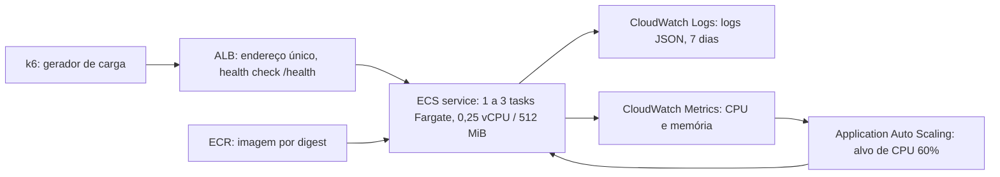

# Orquestração de containers com Amazon ECS — visão geral do projeto

**Disciplina:** Sistemas Distribuídos · **Tema 7:** Amazon ECS · **Equipe:** 4 integrantes · **Entrega final:** 01/12/2026
**Situação deste documento:** 14/11/2026, com base no histórico Git de todas as branches (`git log --all`).

> Este documento resume o projeto, as tecnologias e a contribuição de cada integrante. Os números citados vêm dos arquivos do repositório indicados em cada seção. **Até 14/11/2026 nenhum recurso foi criado na AWS**: todas as medições são locais (Docker com limites equivalentes aos do Fargate) e não substituem os experimentos na nuvem.

## 1. O que o projeto faz

O projeto implanta uma API HTTP simples em várias tasks do **Amazon ECS (Fargate)** e mede, com testes de carga reproduzíveis, três propriedades de sistemas distribuídos:

| Propriedade | Como aparece no projeto | Experimento |
|---|---|---|
| **Replicação** | Várias tasks atendem o mesmo serviço; `/instance` e o header `x-instance-id` mostram qual task respondeu | A (baseline) e distribuição de respostas |
| **Tolerância a falhas** | Com 2 tasks estáveis, uma é encerrada (`stop-task`) e o ECS inicia uma substituta | D (falha) |
| **Escalabilidade** | Target tracking de CPU a 60%, de 1 a 3 tasks, aumenta e reduz o serviço conforme a carga | B (scale-out) e C (scale-in) |

Banco de dados, interface web e funcionalidades de negócio estão fora do escopo (plano da equipe, seção 1).

## 2. Arquitetura



- Linux x86_64, **0,25 vCPU e 512 MiB** por task; VPC existente, subnets públicas com IP público por task, **sem NAT Gateway**.
- Com ALB, as tasks só aceitam tráfego do security group do balanceador; sem ALB, apenas IPv4 `/32` dos participantes.
- Health check do target group a cada 10 s (2 acertos ou 2 falhas) e drenagem de 30 s, para não distorcer os tempos medidos.
- Auto Scaling: mínimo 1, máximo 3 tasks; cooldown de 60 s (scale-out) e 180 s (scale-in).

Fontes: [arquitetura-custos.md](arquitetura-custos.md), [infrastructure/templates/](../infrastructure/templates/), `Set-AutoScaling.ps1` e `Provision.ps1`.

## 3. Tecnologias utilizadas

| Camada | Tecnologia | Uso |
|---|---|---|
| Aplicação | Python 3.12, FastAPI 0.115.6, Uvicorn 0.34.0, AnyIO | API HTTP assíncrona |
| Testes da aplicação | pytest 8.3.4, httpx 0.28.1 | 11 testes automatizados |
| Container | Docker, imagem `python:3.12-slim` (~55 MB), usuário não-root | Empacotamento `linux/amd64` |
| Registro de imagens | Amazon ECR | Imagem com tag fixa e digest |
| Orquestração | Amazon ECS com Fargate, `awsvpc` | Service, task definition, tasks |
| Balanceamento | Application Load Balancer (opcional, recomendado) | Endereço único e health checks |
| Escala | Application Auto Scaling (target tracking `ECSServiceAverageCPUUtilization`) | Scale-out e scale-in |
| Observabilidade | CloudWatch Logs (`awslogs`) e CloudWatch Metrics | Logs JSON, CPU, memória, métricas do ALB |
| Automação | PowerShell 7.2+, AWS CLI v2 | Provisionar, publicar, implantar, testar, limpar |
| Carga | k6 1.0 (imagem `grafana/k6:1.0.0`) | Cenários smoke, calibração, A, B/C e D |
| Análise | Python, matplotlib 3.9.2 | Resumos, gráficos e tabela experimental |
| Ambiente local | Docker Compose, nginx | 3 réplicas atrás de um balanceador local |
| CI | GitHub Actions | Testes da app, checagens offline da infra e validação dos testes de carga |

## 4. Contribuição de cada integrante

A atribuição segue o plano da equipe (versão 1.0, 28/10/2026) e foi conferida nos commits. Os commits da Pessoa 3 estão na branch `origin/pessoa3/experimentos`, ainda **sem merge** em `main` em 14/11.

### Pessoa 1 — Aplicação, Docker e imagem (`LandriAlencars`)

Commit `f8458a6` (12/11): API, Dockerfile e testes.

- **`GET /health`**: retorna `{"status":"ok"}`; usado pelo health check do container e do ALB.
- **`GET /instance`**: ID da task obtido do endpoint de metadados ECS v4 (ou hostname fora do ECS), versão, AZ, PID e uptime.
- **`GET /work?iterations=N`**: N hashes SHA-256 encadeados; operação CPU-bound, custo linear e digest determinístico. Padrão 200 000 iterações, máximo 5 000 000; valor inválido retorna 400.
- Respostas e erros sempre em JSON; headers `x-instance-id` e `x-request-id` em toda resposta.
- Logs JSON em stdout, uma linha por requisição (sem `/health`), coletados pelo CloudWatch.
- Configuração só por variáveis de ambiente, sem segredos: `PORT`, `APP_VERSION`, `INSTANCE_ID`, `LOG_LEVEL`, `WORK_DEFAULT_ITERATIONS`, `WORK_MAX_ITERATIONS` e, depois, `WORK_CONCURRENCY`.
- Evidência de duas instâncias locais com IDs distintos: [app/docs/evidencias/duas-instancias.txt](../app/docs/evidencias/duas-instancias.txt).
- Workflow de CI `.github/workflows/app.yml` (pytest e build da imagem).

Detalhes: [app/README.md](../app/README.md) e [app/docs/relatorio-aplicacao.md](../app/docs/relatorio-aplicacao.md).

### Pessoa 2 — Infraestrutura AWS e implantação (`PabloMuh`)

Commit `551ed20` (08/11): preparação da infraestrutura. Commit `7d825ab` (12/11): formato correto das tags no ECR. PR #1 (`pessoa2/integracao`) mesclado em `main`.

- **Scripts PowerShell** em `infrastructure/scripts/`: `Setup-AwsCli`, `Test-Environment`, `New-DeploymentFiles`, `Provision`, `Publish-Image`, `Deploy`, `Get-Status`, `Test-Deployment` e `Remove-Infrastructure`, com funções comuns em `Common.ps1`.
- **Modelos versionados**: `task-definition.json` (Fargate, 256 CPU / 512 MiB, logs `awslogs`, health check) e `service.json`.
- **Controles de segurança e custo**: os scripts exigem conta conferida, orçamento e janela registrados; marcam os recursos com tags de propriedade e só removem o que comprovadamente criaram; não criam roles IAM, VPC nem NAT Gateway; não versionam credenciais.
- **Testes offline** (`infrastructure/tests/Test-Offline.ps1`) executados no GitHub Actions em Windows, sem acesso à AWS.
- **Documentação**: [checklist-aws.md](checklist-aws.md), [arquitetura-custos.md](arquitetura-custos.md), [contrato-api.md](contrato-api.md), [impedimentos.md](impedimentos.md) e o [roteiro da infraestrutura](../infrastructure/README.md).

### Pessoa 3 — Auto Scaling, geração de carga e testes (`leonardo-lbp`)

Além dos experimentos, a Pessoa 3 fez as correções de integração que desbloquearam os testes de carga.

- **`f2d6cf3` (12/11)**: health check da task trocado de `urllib` por `socket` (`python -S`), com timeout de 10 s: o custo cai de ~0,30 s para ~0,10 s de CPU por execução. O deploy passa a definir `PORT` a partir de `containerPort` e `Publish-Image.ps1` grava `APP_VERSION` com a tag da imagem.
- **`d426ecd` (12/11)**, na área da Pessoa 1, com o OK dela: resolução do **impedimento API-02** (ver seção 5).
- **`cbc0b12` (12/11)**, em conjunto com a Pessoa 2: `Set-AutoScaling.ps1` e `Remove-AutoScaling.ps1` (target tracking de CPU, 1 a 3 tasks, alvo 60%); ajuste do health check do target group e da drenagem; testes offline ampliados para 35 casos.
- **`865b916` (12/11)**: experimentos.
  - `tests/load-test.js` (k6): cenários `smoke`, `calibracao`, `A-baseline`, `BC-escalabilidade` e `D-falha`.
  - `tests/scripts/Invoke-Experiment.ps1`: confere as pré-condições, roda o k6, registra o estado do ECS e do ALB a cada 10 s, executa o `stop-task` em D e exporta métricas, eventos e alarmes (account IDs mascarados).
  - `tests/analysis/analisar.py`: indicadores por fase, tempos de scale-out, scale-in e recuperação, gráficos e tabela experimental consolidada.
  - `tests/local/`: 3 réplicas com 0,25 vCPU e 512 MiB atrás de um nginx, para validar as ferramentas sem AWS.
  - `tests/plano-de-testes.md`: hipóteses, cargas, métricas, critérios e ameaças à validade.

### Pessoa 4 — Observabilidade, pesquisa e documentação

- Este documento, o relatório técnico em PDF ([relatorio-tecnico.pdf](relatorio-tecnico.pdf)) e a apresentação de slides.
- Rastreabilidade: cada número citado indica o arquivo de origem; resultados locais são separados dos resultados na AWS.
- Pendente (até 23/11): validar logs e métricas no CloudWatch com a Pessoa 2, organizar os dados dos experimentos na AWS e produzir os gráficos finais.

## 5. Decisão técnica relevante: o impedimento API-02

Com 0,25 vCPU, vários cálculos de `/work` em paralelo disputavam a GIL do Python e atrasavam o `/health`. Sob carga, o health check falhava e o ECS substituiria tasks saudáveis no meio do scale-out.

| Situação (local, `docker --cpus 0.25`) | Falhas de `/health` (timeout 5 s) | Resultado |
|---|---|---|
| Antes: 20 clientes em `/work` por 60 s | 85% | Container `unhealthy` em 49 s |
| Depois: 20 clientes por 90 s | 0 de 90 | `/health` p50 86 ms, p95 186 ms; `/work` 1,81 req/s |
| Depois: 60 clientes por 60 s | 0 de 60 | `/health` p50 78 ms, p95 173 ms; `/work` 1,80 req/s |

**Correção:** `/health` assíncrono, respondendo direto no event loop; `/work` executado numa thread com no máximo `WORK_CONCURRENCY` (padrão 1) cálculos simultâneos, e os demais pedidos aguardam na fila sem consumir CPU. A vazão por task não muda (~1,8 req/s), mas a latência de `/work` cresce com a fila, e é esse o efeito que o scale-out deve reduzir. Fonte: [validacao-local.md](validacao-local.md).

## 6. Plano de experimentos

As cargas são frações de **C**, a vazão máxima de uma task, medida na calibração do mesmo dia (localmente, C ≈ 1,86 req/s; **no Fargate, C ainda precisa ser medido**).

| Experimento | Tasks | Carga | Mede |
|---|---|---|---|
| A · Baseline | 1, sem Auto Scaling | 0,5 C por 5 min | Vazão, latência p95, erros, CPU |
| B · Scale-out | 1 → 3 | 0,3 C; degraus de 0,85 C (6 min) e 1,5 C (7 min) | Alarme → task saudável no ALB, por degrau |
| C · Scale-in | 3 → 1 | 0,2 C por 22 min + 5 min de observação | Queda da carga → redução das tasks |
| D · Falha | 2, sem Auto Scaling | 0,8 C por 10 min; `stop-task` aos 3 min | Tempo de recuperação e erros na janela da falha |

Os degraus de B ficam abaixo da capacidade das tasks existentes, para que o experimento meça o Auto Scaling e não uma fila crescente. Detalhes: `tests/plano-de-testes.md` (branch `pessoa3/experimentos`).

## 7. Resultados disponíveis: validação local das ferramentas

Ambiente `tests/local` em 13/11/2026: 3 réplicas Docker com 0,25 vCPU atrás de nginx, **sem ECS, ALB nem Auto Scaling**, tempos comprimidos e 1 repetição por cenário. Servem para validar o k6, o orquestrador e a análise, **não** como evidência dos experimentos.

| Execução | Vazão (req/s) | p95 (ms) | Erros | Observação |
|---|---|---|---|---|
| Smoke | 2,26 | 500,0 | 0% | — |
| Calibração | 1,74 | 3 890,6 | 0% | Fila sempre cheia, por desenho |
| A · Baseline | 0,85 | 330,6 | 0% | 1 réplica |
| B/C · Escalabilidade | 1,02 | 398,7 | 0% | 3 réplicas fixas |
| D · Falha | 1,38 | 479,2 | 0,8% | Recuperação em 35 s, dos quais 20 s são atraso simulado; 2 erros em 98 requisições na janela da falha |

Fonte: `tests/results/exemplo-local/tabela-experimental.md` (branch `pessoa3/experimentos`).

## 8. Situação e próximos passos

| ID | Impedimento | Estado em 14/11 |
|---|---|---|
| AWS-01 | Conta do projeto a identificar e validar | Aberto |
| CUSTO-01 | Limite de gastos e janela a acordar | Aberto |
| EXP-01 | ALB e Application Auto Scaling autorizados, ~3 h de sessão | Aberto |
| API-01 | API e Dockerfile não recebidos | Resolvido em 12/11 |
| API-02 | `/health` falhava sob carga | Resolvido em 12/11 |

Até o marco M4 (19/11): validar a conta, provisionar, publicar a imagem, calibrar C no Fargate e executar A, B/C e D (3 repetições, se o orçamento permitir). Depois: gráficos finais, relatório com números da nuvem, custos reais e limpeza dos recursos (`Remove-Infrastructure.ps1`).

## 9. Como reproduzir

```bash
# API sem Docker (a partir de app/)
python3 -m venv .venv && .venv/bin/pip install -r requirements-dev.txt
.venv/bin/pytest -q
.venv/bin/python -m api

# Duas instâncias com Docker
./scripts/local_two_instances.sh
```

```powershell
# Infraestrutura (raiz do repositório, PowerShell 7.2+)
./infrastructure/scripts/Test-Environment.ps1 -Offline
./infrastructure/tests/Test-Offline.ps1
```

O roteiro completo da AWS está em [infrastructure/README.md](../infrastructure/README.md); o dos experimentos, em `tests/README.md`.

## 10. Referências

- Yerram, S. *AWS EKS vs AWS ECS: A Research-Based Comparison for Container Orchestration*. Zenodo, 2025. <https://zenodo.org/records/16500754>
- AWS. *What is Amazon ECS?* <https://docs.aws.amazon.com/AmazonECS/latest/developerguide/Welcome.html>
- AWS. *Automatically scale your Amazon ECS service.* <https://docs.aws.amazon.com/AmazonECS/latest/developerguide/service-auto-scaling.html>
