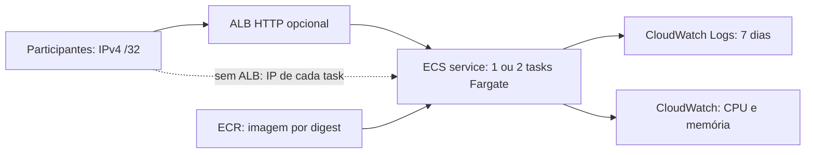

# Arquitetura inicial, custos e evidências

## Arquitetura

Linux x86_64, 0,25 vCPU/512 MiB por task. Uma VPC existente, subnets públicas e IP público por task para saída via Internet Gateway. Não provisionamos NAT Gateway. Com ALB, duas AZs e entrada nas tasks somente a partir do SG do balanceador. Sem ALB, somente `/32` dos participantes na porta da aplicação; a URL muda na substituição da task e não existe distribuição automática por endereço único.

O número desejado começa em um; duas tasks validam replicação. O deploy usa sobreposição de até 200% e pode consumir quatro tasks temporariamente no redeploy de um serviço com duas réplicas.

O Auto Scaling dos experimentos B e C (`Set-AutoScaling.ps1`) mantém de 1 a 3 tasks pela CPU média do serviço. O roteiro completo dos experimentos ([plano de testes](../tests/plano-de-testes.md)) usa cerca de 3 horas de ALB, com 1 a 3 tasks. Inclua isso na estimativa da sessão de experimentos.

## Estimativa antes de provisionar

Não há valor preenchido porque **região, créditos, janela e limite ainda não foram definidos**. Na região escolhida, estime e registre em USD:

| Componente | Quantidade a considerar |
|---|---|
| Fargate | Horas de tasks × 0,25 vCPU e 0,5 GiB, incluindo inicialização e sobreposição de deploy |
| IPv4 público | IP-horas das tasks e, se aplicável, do ALB |
| ALB | Horas do balanceador e unidades de capacidade durante a janela |
| ECR | Armazenamento das imagens e eventuais transferências |
| CloudWatch | Ingestão/retenção de logs e operações/métricas aplicáveis |
| Rede | Transferências aplicáveis conforme região/origem/destino |

Use a [AWS Pricing Calculator](https://calculator.aws/) e preços oficiais de [Fargate](https://aws.amazon.com/fargate/pricing/), [ELB](https://aws.amazon.com/elasticloadbalancing/pricing/), [VPC/IPv4](https://aws.amazon.com/vpc/pricing/), [ECR](https://aws.amazon.com/ecr/pricing/) e [CloudWatch](https://aws.amazon.com/cloudwatch/pricing/). Créditos não significam ausência de cobrança. Confira a cobertura real da modalidade de conta.

O registro `budget` é um controle de processo, não um limitador financeiro ou desligamento agendado. Reserve a janela e encerre os recursos manualmente usando o procedimento de limpeza. Desejado zero não remove ALB, repositório nem armazenamento de logs.

## Evidências para a pessoa 4

- Relatório de viabilidade, decisão de arquitetura e estimativa registrada.
- URI/tag/digest, revisão da task definition, região e timestamps UTC.
- JSONs enviados, inventário dos recursos e estado desejado/em execução.
- Logs/streams, métricas de CPU/memória e eventos ECS; resultados reais de HTTP e IDs de réplicas.
- Evidência de redeploy e relatório de limpeza com recursos preservados.

Os arquivos gerados ficam locais até serem revisados. Não declarar melhora de desempenho ou recuperação de falha com base apenas em duas tasks saudáveis: esses resultados dependem dos experimentos seguintes.
